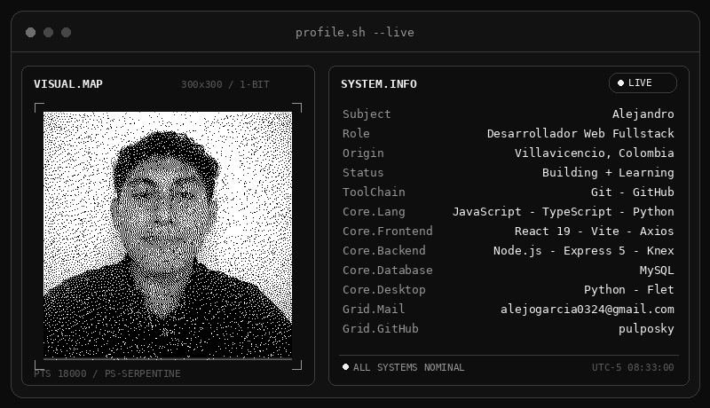
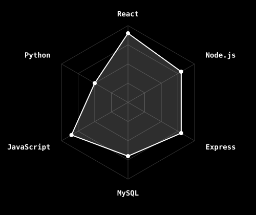

 

 

  

 

## 🙋 Sobre mí

Soy **Alejandro**, desarrollador web de **Villavicencio, Colombia**, con experiencia construyendo proyectos fullstack con el ecosistema **Node.js**. Me apasiona aprender cosas nuevas rápidamente y siempre estoy buscando mejorar mis habilidades.

Mi camino me ha llevado desde **HTML, CSS y JavaScript** hasta **Node.js + MySQL**, y hoy sigo expandiéndome en dos direcciones: consolidarme como desarrollador **fullstack** con **React + Vite** en el frontend y **Express 5 + Knex** en el backend, y explorar aplicaciones de escritorio con **Flet (Python)**.

Me defino como una persona **colaborativa, responsable y honesta**, que disfruta trabajar en equipo y aportar soluciones concretas a los problemas.

---

## 🛠️ Tecnologías

  

---

## 📊 Estadísticas

---

## 🐍 Grilla de contribuciones

<picture>
  <source media="(prefers-color-scheme: dark)" srcset="dist/github-contribution-grid-snake-dark.svg" />
  
</picture>

---

## 📂 Proyectos destacados

### ⚙️ [fullstack-learning](https://github.com/pulposky/fullstack-learning)

Proyecto personal de práctica para nivelar el trabajo fullstack: **React (JSX)** en el cliente y **Node.js/Express + Knex** en el servidor. Evoluciona progresivamente de JavaScript a **TypeScript**. Cubre React con componentes, props, estado y JSX; React Router para navegación; CSS Modules; API REST con Express; acceso a MySQL mediante Knex (query builder); migraciones y frontend organizado con **Atomic Design** (`atoms/`, `molecules/`, `organisms/`, `templates/`).

> **Frontend:** React 19 · Vite · React Router · CSS Modules · Axios
> **Backend:** Node.js · Express 5 · Knex · MySQL

### 🛒 [Sistema_POS](https://github.com/pulposky/Sistema_POS)

Sistema POS en **Python con Flet** para gestión de ventas, remisiones, clientes y productos. Inventario en tiempo real, registro de ventas y control de caja, y generación de **facturas PDF**. Incluye instalador configurado con **PyInstaller** y se conecta con el **Marketplace Web** compartiendo la misma base de datos `senapdv`.

### 🛍️ [Marketplace](https://github.com/pulposky/Marketplace)

Plataforma de comercio web en **JavaScript** (Node.js + Express + EJS + MySQL): catálogo público con búsqueda y filtros, sistema de apartados con notificaciones, dashboard de estadísticas y registro de visitas. Se integra con el Sistema POS vía base de datos compartida.

---

## 🌱 Lo que estoy aprendiendo ahora

- **Frontend:** React 19, Vite, React Router, Axios, CSS Modules
- **Backend:** Express 5, Knex (query builder), MySQL, JWT, Bcrypt
- **Migración:** JavaScript → **TypeScript** en frontend (`.tsx`) y backend (`.ts`)
- **Arquitectura:** Atomic Design (átomos, moléculas, organismos, templates)
- **Escritorio:** Python + Flet

---

## 🧠 Soft skills

- 🤝 **Colaborativo**: Trabajo bien en equipo y me adapto a diferentes dinámicas de trabajo
- ✅ **Responsable**: Cumplo con los compromisos y plazos establecidos
- 🤲 **Honesto**: Comunicación clara y transparente en todo momento
- ⚡ **Aprendizaje rápido**: Capacidad de asimilar nuevas tecnologías y conceptos con agilidad

---

## 📬 Contáctame

  

*"El mejor código que puedo escribir hoy es mejor que el que escribí ayer."*

⭐ Si alguno de mis proyectos te es útil, ¡no dudes en dejar una estrella!

