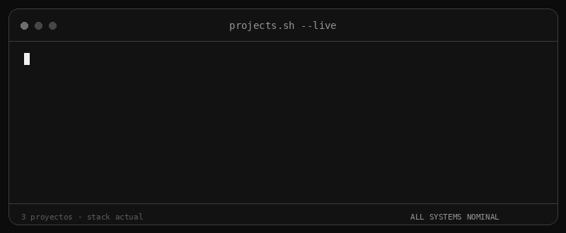

 

 

 

Soy **Alejandro**, desarrollador web de **Villavicencio, Colombia**, con experiencia construyendo proyectos fullstack con el ecosistema **Node.js**. Me apasiona aprender rápido y mejorar en cada proyecto.

Hoy me enfoco en dos caminos: consolidarme como desarrollador **fullstack** con **React + Vite** en el frontend y **Express 5 + Knex** en el backend, y explorar aplicaciones de escritorio con **Flet (Python)**.

Trabajo bien en equipo, cumplo con mis compromisos y prefiero la comunicación clara.

  

<picture>
  <source media="(prefers-color-scheme: dark)" srcset="dist/github-contribution-grid-snake-dark.svg" />
  
</picture>

### ⚙️ [fullstack-learning](https://github.com/pulposky/fullstack-learning)

Proyecto de práctica para nivelar el trabajo fullstack: **React (JSX)** en el cliente y **Node.js/Express + Knex** en el servidor, migrando progresivamente de JavaScript a **TypeScript**. Incluye React Router, CSS Modules, API REST, acceso a MySQL con Knex y una estructura con **Atomic Design**.

### 🛒 [Sistema_POS](https://github.com/pulposky/Sistema_POS)

Sistema POS en **Python con Flet** para ventas, remisiones, clientes y productos. Tiene inventario, registro de ventas, control de caja y generación de **facturas PDF**. Incluye instalador con **PyInstaller** y comparte la base de datos `senapdv` con el Marketplace.

### 🛍️ [Marketplace](https://github.com/pulposky/Marketplace)

Plataforma de comercio web con **Node.js, Express, EJS y MySQL**: catálogo con búsqueda y filtros, sistema de apartados con notificaciones, dashboard de estadísticas y registro de visitas. Se integra con el Sistema POS mediante una base de datos compartida.

- **Frontend:** React 19, Vite, React Router, Axios, CSS Modules
- **Backend:** Express 5, Knex, MySQL, JWT, Bcrypt
- **Migración:** JavaScript → **TypeScript** (`.tsx`, `.ts`)
- **Arquitectura:** Atomic Design
- **Escritorio:** Python + Flet

- 🤝 **Colaborativo:** me adapto a distintas dinámicas de equipo
- ✅ **Responsable:** cumplo compromisos y plazos
- 🤲 **Honesto:** comunicación clara y transparente
- ⚡ **Aprendizaje rápido:** asimilo tecnologías nuevas con agilidad

Escríbeme si quieres hablar de un proyecto o colaboración:

  

⭐ Si alguno de mis proyectos te es útil, deja una estrella.

